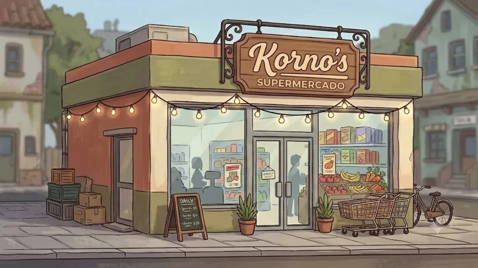

# Korno's

Jogo educativo de matemática feito em Godot 4 pelo Grupo 07 do curso técnico em Desenvolvimento de Sistemas do IFSP, câmpus São Paulo, como Trabalho de Conclusão de Curso.

**Site do projeto:** https://jogokorno-s.github.io/principal/



## A ideia

O Belo é traído pela esposa, Grazi, que vai embora com o Maurício. Ele fica sem casa, sem dinheiro e sozinho com o filho, o Enzo. Pouco depois, o avô José morre e deixa de herança um mercadinho de bairro velho, sujo e quase falido: o Korno's.

O jogador ajuda o Belo a reerguer o mercado em cinco dias. Não tem personagem andando pelo mapa: o jogo acontece em telas fixas, no estilo de *Good Pizza, Great Pizza*, com diálogos, clientes no balcão e um minigame de matemática por dia. Acertar a conta enche o caixa, e errar sai do bolso do Belo.

Depois de cada minigame, o jogo mostra como um computador resolveria o mesmo problema. Essa é a parte de matemática computacional do trabalho.

| Dia | Minigame | Matemática | O que o computador usa |
|---|---|---|---|
| 1 | Compra no atacadista | operações com decimais | problema da mochila |
| 2 | Caixa e troco | porcentagem, acréscimo e desconto | algoritmo guloso |
| 3 | Moto Entrega | velocidade média e consumo (km/L) | grafos e Dijkstra |
| 4 | Câmeras de segurança | trigonometria e perímetro | problema da galeria de arte |
| 5 | Prateleira de refrigerantes | análise combinatória | força bruta × fórmula |

A explicação completa de cada um, com exemplo resolvido, está na página [A matemática](https://jogokorno-s.github.io/principal/matematica.html) do site.

## O que já funciona

- Menu inicial com vídeo de fundo
- Abertura com 11 cenas (imagens e vídeos) e texto aparecendo letra por letra
- Tutorial na fachada do mercado, com o Luís explicando o que fazer
- Interior do mercado abandonado, primeira tela jogável
- Estado do jogo global (`GameState`) e transição entre cenas (`SceneTransition`)

Em desenvolvimento: os cinco minigames, o caixa e a exportação para navegador e Windows.

## Como abrir o projeto

1. Instale o [Godot 4.7](https://godotengine.org/download) (versão padrão, não a .NET).
2. No Godot, clique em **Importar** e escolha o arquivo `kornos/project.godot`.
3. Aperte **F5** para rodar.

## Exportar para o navegador

O site embute o jogo a partir da pasta `docs/play/`. Para gerar essa versão:

1. Em **Projeto → Configurações do Projeto → Renderização**, troque o renderizador para **Compatibility**. A exportação web do Godot 4 não funciona com o Forward+, que é o que o projeto usa hoje.
2. Em **Projeto → Exportar**, adicione a predefinição **Web** e **desligue "Thread Support"**. Sem isso, o jogo fica com a tela preta no GitHub Pages.
3. Exporte para `docs/play/index.html` (o nome do arquivo tem que ser `index.html`).

Assim que esse arquivo existir no repositório, a página **Jogar** do site carrega o jogo sozinha.

## Como o repositório está organizado

```text
kornos/            projeto do Godot
  art/             fundos, personagens e interface
  scenes/          cenas (.tscn): main, story, locations, characters
  scripts/         código em GDScript
  videos/          vídeos do menu e da abertura (.ogv)
docs/              site do projeto, publicado pelo GitHub Pages
  docs/            GDD, arquitetura de cenas e slides em PDF
  play/            onde entra a exportação web do jogo
```

As instruções para editar o site estão em [`docs/README.md`](docs/README.md).

## Arquitetura

O projeto segue MVC adaptado ao Godot:

- **Model:** o autoload `GameState` guarda dia, nível, XP, dinheiro e áreas liberadas, e é acessível de qualquer cena.
- **View:** as cenas `.tscn` só desenham a tela e recebem cliques.
- **Controller:** o script de cada cena reage ao clique, altera o `GameState` e atualiza a tela.

Os textos da abertura ficam em uma lista dentro de `scripts/intro.gd`, separados da lógica que exibe as cenas.

## Documentos

- [Game Design Document](docs/docs/kornos-gdd-v2.docx)
- [Arquitetura de cenas e fluxo do jogo](docs/docs/arquitetura-de-cenas.pdf)
- [Apresentação de Matemática Computacional, 3º bimestre](docs/docs/matematica-computacional-3bim.pdf)

## Equipe

Grupo 07 · Desenvolvimento de Sistemas · IFSP câmpus São Paulo · 2026

- Luis Carlos Souza da Silva
- Rhayane Ribeiro Pimentel
- Sabryna Andrade de Almeida
- Sofia Isabelli de Carvalho Santos
- Vitória Xavier Pereira

Orientação: João Temochko e Felipe Marcos Pinto
